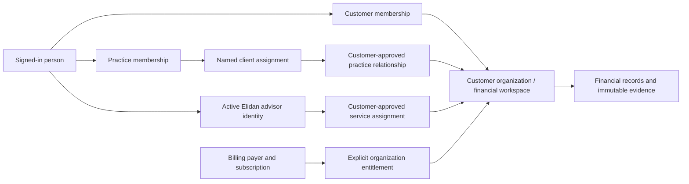

# ORG-01A — organization ownership and access contract

28 October 2026. Architecture increment for the platform-first work requested by the owner. This contract defines the target model and migration gates; it does not create tables, grant access, change Stripe billing, enable team seats or launch Advisory. Runtime behavior remains account-scoped until the later increments below pass preview verification. QuickBooks remains parked.

## Purpose and decisions

The customer's business owns its financial record. A person signs in and acts on that record through an explicit, current access relationship. A subscription funds capabilities; it does not establish ownership or professional access. Core, Growth and Advisory use the same underlying evidence, financial definitions and versions.

1. A customer organization is the financial workspace and isolation boundary. In the first migration it has one existing business profile. Organization and workspace are two names for this same boundary, not two nested permission systems. Multiple legal entities or consolidated books require a later explicit model.
2. Users may belong to multiple organizations, and organizations may have multiple users. A professional practice is a separate organization that can have relationships with multiple customer organizations. The practice's own books, if needed, belong to a separate customer workspace.
3. Direct customer memberships, professional-client relationships and Elidan advisor assignments are separate access paths. None implies the others. Customer data never becomes practice-owned or advisor-owned when access is granted.
4. An organization's owner, its billing payer, the author of a financial change and the person currently viewing it are separate identities. Ownership transfer changes no Stripe customer, subscription, charge, Founding identity or historical author.
5. Default professional/advisor access is read-only, customer-scoped, time-bounded and revocable. Acting on a different client always requires another explicit authorization.
6. Move existing accounts incrementally. Preserve IDs, financial values, source snapshots, published versions and existing billing links. Opening collaboration before converting its database authorization paths is prohibited.

## Current implementation and migration constraints

Repository code and a read-only inspection of the confirmed Supabase **preview** catalog on 28 October establish this baseline. No production catalog or customer records were inspected. The preview catalog inspection used a read-only transaction and changed no data. This is a scoped architecture inventory, not a complete security audit.

| Area | Existing boundary | Consequence for the migration |
| --- | --- | --- |
| Business identity | `business_profiles.user_id` is unique and references Auth with `ON DELETE CASCADE`. | Keep `business_profiles.id`; map that profile to an organization instead of creating another copy of its books. Auth-user deletion must stop owning the business lifecycle before multi-user launch. |
| Monthly data and categories | `user_id` is authoritative; nullable `business_id` points to the profile with `ON DELETE SET NULL`. Monthly uniqueness is `(user_id,month_date)`. | Backfill organization from a checked profile/legacy mapping; change ownership and uniqueness together. A null or mismatched profile must not create an unscoped record. |
| Actions and history | Actions contain account/profile scope; action/forecast links include the owning `user_id`. Action audit entries are account-scoped and action deletion can remove their history. | Migrate linked resources with organization-qualified FKs. Preserve historical authors separately from legacy ownership; broader access auditing cannot depend on deletable action history. |
| Forecasts, cases, cash actuals and reviews | Composite keys/FKs include `user_id`; one active forecast is account-scoped; published evidence is immutable. | Migrate the entire graph consistently. Existing triggers forbid updates to published rows and allow some deletion only when the Auth owner disappears. Do not disable immutability casually to backfill ownership. |
| Imports and Clear Data | Service RPCs take an account ID and serialize on `business_profiles`; review tokens bind the user, file/mode and state version. | Introduce explicit actor/organization arguments and verify authorization inside the write transaction. Bind new review tokens to both actor and organization. Clear Data remains a separately authorized, bounded monthly-data operation. |
| Billing and quotas | `subscriptions.user_id` is unique. Usage uniqueness is `(user_id,metric,period_start)`; action capacity locks the account subscription. | Bridge existing billing to one legacy organization. Convert quota/capacity enforcement atomically before members can consume shared allowances. |
| HTTP and browser access | `requireAuth` proves the actor; `checkFeatureGate`, `proxy.ts`, loaders and RLS usually use that actor's account/subscription. | Authentication is reusable. An actor's own subscription and `user_id` filters are insufficient to authorize work in a client's organization. Replace the boundary by domain, including direct database reads. |
| Personal/product communications | Session audits, feature-interest registration, Founding registry and much email work are user-scoped. | Retain personal identity where appropriate. Add organization context only to business-specific events/messages; never copy another member's billing or session records into a client workspace. |
| Paid human calls | `cfo_calls` currently records an account purchase from the Stripe webhook. | Preserve purchase/payment identity. A paid call alone grants no financial access; future fulfillment links an explicit customer organization and engagement through ADV-01. |
| Parked integrations | QuickBooks connection metadata already uses `business_id`, actor and generation; callbacks still verify the account-owned profile. | Preserve the completed preview work. Organization conversion of provider ownership, callback and job authorization is a future dependency when integration work resumes. |

Code references: [authentication](../lib/apiAuth.ts), [feature gate](../lib/apiGate.ts), [database operations](../lib/db.ts), [proxy](../proxy.ts), [review signing](../lib/financialImportReviewToken.ts), [forecast storage](migrations/2026-10-25-cash-forecast-storage.sql), [immutable reviews](migrations/2026-10-27-forecast-variance-storage.sql), [action capacity](migrations/2026-10-23-action-capacity-guard.sql), [atomic usage](migrations/2026-10-25-atomic-usage-consumption.sql) and [Clear Data](migrations/2026-10-24-preserve-settings-on-financial-clear.sql). Older base-schema definitions are not all present as repository migrations; each executable migration must preflight its actual target catalog.

## Target records

These are logical records for subsequent migrations, not executable SQL or existing table claims.

| Record | Identity, relationships and required constraints |
| --- | --- |
| `organizations` | Stable UUID, kind `customer` or `practice`, display name, lifecycle `active/archived`, access revision and timestamps. Creation metadata is attribution, never permanent ownership. At least one active owner must exist before activation. |
| `organization_memberships` | Organization + Auth user, role `owner/admin/editor/viewer`, active/revoked state, revision, granting actor and timestamps. One current membership per organization/user; append changes to separate audit history. Ownership cannot be self-selected. |
| `organization_user_restrictions` | Organization + user, active suspension/cleared state, reason, authorizing actor and revision. An active suspension overrides every membership, practice and advisor path for that user in this customer organization; it is distinct from ending just one grant. |
| `organization_export_grants` | Organization + named principal, explicit export capability, validity, granting actor and revision. Initially seeded only for the mapped legacy owner; no role or higher-tier personal plan implicitly creates bulk-export rights. |
| `legacy_account_organizations` | One live mapping per legacy Auth owner and one unique preserved business-profile ID map to a customer organization. Detached historical mappings may remain after profile deletion; they do not sponsor another live workspace. Internal compatibility metadata, not a substitute membership and never accepted from a client. |
| `organization_invitations` | Customer/practice organization, verified-recipient email identity, bounded role, hashed high-entropy token, expiry, issuer, revision and pending/accepted/revoked/expired outcome. No financial access while pending. |
| `professional_client_relationships` | Exact customer and practice organization, customer authorization, allowed capability ceiling, mandatory start/end, active/revoked state and revision. Directional relationship; not a merger or parent-child ownership hierarchy. |
| `professional_client_assignments` | Relationship + named active practice member, explicitly approved capability subset, validity and revision. New practice employees do not inherit every customer. |
| `advisor_assignments` | Exact customer organization + named active Elidan advisor + service-engagement reference, customer consent, allowed capabilities, mandatory start/end, assigning operator, status and revision. ADV-01 owns service fulfillment; ORG-01 owns the access contract. |
| `organization_billing_links` | Organization → trusted billing account/subscription reference with explicit coverage. Initial bridge points to the existing payer's subscription; billing-manager authorization is separate from membership role. Prevent simultaneous competing active coverage. |
| `billing_account_authorities` | Billing account + named user + billing capability and revision. Seed existing payer authority during the bridge. This record can authorize billing administration without customer financial access and does not make the payer an owner. |
| `organization_access_events` | Append-only organization/actor/target/action/outcome/time, grant and policy revision, request/operation ID and before/after access state. No invitation tokens, provider secrets or raw financial payloads. Actor deletion may tombstone identity; it must not cascade away required organization history. Retention policy is a separate release decision. |

Business data carries an authoritative non-null `organization_id` after conversion. Actors use separate `created_by/updated_by/published_by` fields with a documented legacy-provenance marker where authorship was not recorded. A legacy ownership column must never be relabelled as proven historical authorship. Organization IDs on children must agree with their parent through composite FKs or equally strong database constraints; validating only the top-level route is insufficient.

## Direct-member permission matrix

This is the target baseline. Every product operation also checks organization lifecycle, feature availability, entitlement and relevant data readiness. A role does not promise a tier feature or a seat package that is not sold today.

| Operation | Owner | Admin | Editor | Viewer |
| --- | --- | --- | --- | --- |
| Read customer-visible financial records, evidence and published results | Yes | Yes | Yes | Yes |
| Run a temporary permitted calculation without saving | Yes | Yes | Yes | Yes |
| Add/correct routine financial entries; reviewed update-months import | Yes | Yes | Yes | No |
| Prepare/edit a forecast or case draft | Yes | Yes | Yes | No |
| Publish a plan/case or save an authoritative completed-week review | Yes | Yes | No | No |
| Update business thresholds and operational settings | Yes | Yes | No | No |
| Invite/revoke editor or viewer; review non-sensitive access history | Yes | Yes | No | No |
| Grant/revoke admin or complete an ownership transfer | Yes | No | No | No |
| Approve/revoke professional or advisor access within its fixed scope | Yes | Yes | No | No |
| Replace the complete monthly dataset, Clear Data or request organization deletion | Yes, explicit confirmation | No | No | No |
| View bulk exports/downloads or establish persistent data delivery | Explicit export capability | Explicit export capability | Explicit export capability | Explicit export capability |
| Manage Stripe billing, payer identity or payment history | Separate billing authority | Separate billing authority | Separate billing authority | Separate billing authority |
| Read another person's sessions, personal settings or another client's records | No | No | No | No |

An initial legacy owner receives explicit billing-management authority for the existing payer link and an export capability; these are separate grants, not implied forever by `owner`. No advisor/practice identity receives them by default. Individual UI record reads and bulk export are different capabilities; technical read access cannot prevent a recipient from copying information they legitimately received.

Use a closed, versioned capability vocabulary in the resolver, with names such as `financial.read`, `monthly.import_update`, `monthly.replace_all`, `forecast.draft_write`, `forecast.publish`, `review.save`, `action.write`, `access.members.manage`, `access.owner.transfer`, `export.bulk` and `billing.manage`. Unknown capabilities deny by default. The server chooses the required capability from its operation; request bodies cannot choose a weaker one. A case-draft capability is a future preparation workflow: today's E5 save creates an immutable published alternative and must remain publisher-only when converted unless a real separate draft lifecycle is added.

Every active organization must retain at least one active owner. Serialize owner removals/transfers on the organization row; two concurrent removals cannot each conclude that the other owner will remain. Adding an owner requires the ownership-transfer/elevation flow, recipient acceptance and recent authentication; ordinary invitations cannot grant owner. An admin may not create or modify an invitation beyond editor/viewer or elevate itself. Owners may invite an admin through the privileged path. Permission changes invalidate pending operations whose authority depended on the old grant.

Professional and advisor access starts with customer-visible read capabilities only. Additional capabilities such as drafting or publishing require separate customer-authorized, named grants within the relationship ceiling. Their maximum scope excludes organization ownership, membership administration, billing, provider credentials, destructive data operations and private notes from another engagement. An external professional who needs business-administrator authority must receive a separate, explicit customer membership; a practice relationship never silently upgrades to one. Ending that relationship does not revoke unrelated direct memberships, so the customer access screen must show every independent access path and offer an explicit revoke-all action where authorized.

## Professional clients, advisors and private notes

A practice member needs **both** active practice membership and an active named assignment under a customer-approved relationship. Effective capabilities are the intersection of the relationship ceiling, that staff assignment and the staff member's practice permissions. A practice admin manages the practice's own members but gains no automatic financial access to every client. Replacing an assigned professional requires customer approval in the first release; automatic staff substitution is a later explicit policy. Removing a practice member disables its client access without touching customer data.

An Elidan advisor needs an active internal advisor identity and an active customer-approved assignment within an eligible engagement. Internal operator authority may administer an assignment but does not itself grant customer financial read access. Being an Elidan employee, having an email domain or appearing in a development superuser list confers no production access. Service purchase, active subscription, meeting booking and named advisor authorization remain distinct states. Grant validity uses the database clock and the half-open interval `starts_at <= now < ends_at`; missing expiry or invalid scope denies delegated access.

Professional internal notes and customer-visible deliverables need separate records/policies. Internal notes belong to the authoring practice or Elidan service context and reference only the exact customer relationship/engagement. Customer financial ownership does not automatically expose a practice's internal notes; internal authorship does not make copied customer financial evidence available after client access ends. First-release UI access to client-related internal notes requires the active client relationship/assignment as well as provider-side note permissions. Any later offboarding archive access requires an explicit retention policy and separate workflow. Delivery to a customer creates a deliberate, versioned customer-visible record; it is never a visibility flag accidentally applied to an internal row. No note implementation is included in ORG-01A.

## Authorization contract

For a protected operation, resolve a verified actor, requested action and explicit target organization. The target identifier is a selector, not proof of access. Load resource scope from the database and verify it matches the selected organization. Resolve a **complete qualifying access path** from current persisted grants. Never combine half of a practice relationship with half of an unrelated advisor assignment to manufacture permission. Several valid paths may coexist; revoking one path removes only that path. An explicit organization-level user suspension overrides all paths and is included in the access revision and audit contract.

Return an internal context containing actor ID, organization ID, capability, qualifying grant IDs/revisions, organization access revision, policy version, billing-coverage reference where needed and evidence/data version where needed. Do not return another member's payer/payment details. The result is short-lived request context, not an irrevocable token.

The decision has separate checks:

1. **Identity:** validated Auth session and verified email; no actor identity from form fields or an organization cookie.
2. **Scope:** organization exists, selected resource belongs to it and lifecycle permits the action. Return a non-enumerating response for foreign resources.
3. **Authority:** a current complete membership/relationship/assignment path permits that capability and no overriding suspension applies.
4. **Product availability:** the capability is launched; a high tier cannot bypass an unavailable endpoint.
5. **Entitlement:** the target organization has the required trusted subscription/service coverage, not merely the actor's personal plan.
6. **Readiness:** the normalized evidence supports the requested finance operation. Readiness never creates access; a missing input is distinct from a permission denial.
7. **Atomic enforcement:** a mutating RPC repeats authority, scope, revision, entitlement, capacity and stale-evidence checks while holding the required locks, then commits the result and audit together.

Control operations such as revocation, ownership recovery and permitted access/billing administration must remain reachable when a subscription lapses. Lapse must not prevent a customer from ending delegated access. Financial read/write availability after lapse follows the explicit product policy; this contract does not introduce a new free-access promise or widen existing runtime routes. Authentication/verification recovery and the payer's own billing administration retain their separate boundaries.

The database remains authoritative for direct browser reads and all writes. RLS must constrain organization scope even if a browser changes IDs or skips the UI. Privileged RPCs use a fixed search path and least-privilege execution grants. Authenticated callable functions bind actor to `auth.uid()`; service-only functions accept an actor only from the verified server boundary and repeat organization authorization inside the transaction. A service-role bypass is not evidence that a job or person is authorized. Membership-policy helper functions must avoid recursive RLS lookups; their design and execute grants require direct negative SQL tests before rollout.

Concurrent writes and access changes serialize through their authoritative authorization dependencies. Existing financial writes still need the preserved business-profile/data-version lock. Establish one lock order across **all converted** paths: participating organization authorization rows in stable UUID order → authorization/principal grant rows in stable key order → business profile where relevant → billing/capacity rows where relevant → parent financial resource → child/resource or usage row. Never acquire an earlier lock after a later lock. A delegated operation includes its practice organization and current staff membership, or the active advisor identity, in the dependencies it locks/rechecks; checking only the customer's revision would miss professional offboarding. Legacy owner-only operations keep their current order until a domain is converted; multi-user enablement waits until all its interacting writers use the new order.

Customer-scoped grant changes lock/bump the affected customer authorization revision. Practice offboarding or advisor-identity revocation changes the authoritative root revision and immediately invalidates contexts derived from it; cache invalidation may fan out, but correctness cannot depend on that fan-out finishing. A writer must reread the locked root grant after waiting, not reuse its preflight result. A revoked writer waiting on an authorization dependency must fail, while a write that committed before revocation remains an attributable historical event. Lock contention tests must include both customer revocation and practice/advisor root revocation.

Reads check current authority per request/statement; revocation does not retract bytes already delivered or cancel a read already running on its database snapshot. Avoid long-lived signed financial URLs. Future exports/downloads and background jobs recheck access at execution and delivery and carry target organization, requesting actor or explicit automation principal, operation key and authorization/source generations. A personal grant captured at enqueue time is insufficient. Scheduled organization automation needs its own approved capability/principal policy; it must not impersonate the current owner.

## Invitations, client switching and revocation

Invitation tokens use at least 32 random bytes and are stored only as hashes, with a maximum seven-day lifetime. The recipient must sign in, verify the bound email and explicitly accept. Match the verified Auth email under a documented trim/case policy; do not infer identity from a display name, email domain or provider-specific alias stripping, and never merge Auth users. The issuer must still have grant authority at acceptance; a revoked/demoted issuer invalidates outstanding invitations issued under that authority. Role changes invalidate the old token/revision. Acceptance locks the organization, checks current entitlement/seat availability, consumes the invitation once, creates/reactivates one membership and appends an audit event atomically. A duplicate acceptance by the same recipient returns the established result without resetting roles or counters; another recipient cannot reuse it.

First-release seat capacity is checked at acceptance, not promised by sending an invitation. Concurrent acceptances compete under one organization lock; pending invitations grant neither access nor a paid seat. Replaying an already accepted invitation after membership revocation must not reactivate access; readmission requires a new authorized invitation. Abuse limits for pending invitations, resend rate and email delivery are required in the invitation increment. Downgrades do not delete records or automatically promote/demote roles. If purchased collaboration coverage is lost, delegated access is suspended under a documented policy while the owner can still revoke/manage it. Seat numbers, which tiers may invite and any practice package require a commercial decision before this path launches.

Client switching lists only currently accessible organizations and their permitted display metadata. The server reauthorizes every request even after a switch. No global fallback to the first organization or to another member's legacy account is allowed. A saved organization selector is a preference only; an unauthorized/deleted selection presents a choose-workspace state. Abort/ignore old in-flight responses when switching, clear client financial state, and scope caches, drafts, idempotency keys and safe browser-storage keys by actor + organization + relevant policy/data revision. A response for client A must never paint client B's screen. On logout clear in-memory organization state. One workspace's billing tier, alert dismissal or quota response cannot leak into another.

Revocation, expiration, organization suspension and role changes take effect through persisted authorization, not a stale JWT role claim or a cache-only event. Invalidate affected sessions' organization caches and bump the relevant access revision. Queued writes and downloads must fail their final checks. Audit actor, organization, grant, target, outcome and time without secret tokens or financial payloads; customer audit visibility must not reveal another practice's clients, private notes, personal sessions or payer details.

## Billing, tiers and personal settings

The initial billing conversion bridges each existing subscription and payer to its one mapped customer organization without creating a new subscription. Existing Stripe IDs, amounts, billing-cycle dates, cancellation behavior and webhook event identities remain unchanged. Webhooks continue to resolve their trusted subscription identity; they do not take an active client selector or guess the organization from the latest viewer. Duplicate or delayed events retain current ledger/idempotency guarantees. A payer's separate organization does not inherit the same coverage unless an explicit future package says so.

Owner transfer requires an explicit verified recipient and authorization, updates ownership/membership atomically, and does not transfer billing authority or a payment method. The outgoing payer may retain only its separate billing-account authority; that authority cannot read customer financial records. Payer replacement requires a separate confirmed billing workflow and is not included here. Founding member numbers/badges remain personal registry identity, and current Core/$49 benefits follow the existing qualifying subscription; neither a teammate nor a transferee receives a new Founding spot by joining an organization.

Plan quota and active-action capacity become shared **organization** budgets, preserving the current amount for the mapped legacy organization rather than multiplying it per seat. Actor attribution remains separate for audit and fair-use controls. Usage migration preserves current-period counts and idempotency receipts; joining/leaving or switching clients never resets allowances. Shared-budget conversion cannot be enabled by simply changing `user_id` filters while old counters still run. A future professional practice pool or purchased service allowance needs an explicit coverage/allocation policy; one client's tier never unlocks another client.

Current runtime gates remain the baseline: Core weekly base forecasting, Growth weekly reviews and retained cases, and Advisory-gated team-seat capability. Growth and Advisory sales remain disabled in `launchConfig.ts`. ORG-01 defines how capabilities compose with roles; it does not alter those gates, prices or launch flags. Adding a role row or an advisor assignment is not a sale, subscription upgrade or proof of fulfillment. All tiers retain the same calculation accuracy and material data-quality warnings.

Business name, finance thresholds, reporting policy and source data/version are organization settings. Password, verification, personal notification preferences and session history belong to the person. Alert dismissals become actor + organization + alert/evidence-version state. Existing owner dismissals map only to that owner's legacy organization. A member's personal snooze cannot hide a material warning for every member; any future organization-wide acknowledgment is a separate auditable operation. Existing financial Clear Data semantics preserve business settings and retained plans/reviews as currently documented; deleting an organization is a distinct lifecycle operation.

## Migration plan and release gates

| Increment | Bounded implementation | Exit evidence |
| --- | --- | --- |
| **ORG-01A — this contract** | Inventory current ownership constraints; define model, permissions, billing boundaries, migration and adversarial acceptance. | Reviewed against repo and preview catalog. No schema/RLS/customer behavior changes. |
| **ORG-01B — shadow organization storage** | [B requirements](org-01b-shadow-organizations-design.md) and [implementation evidence](org-01b-preview-validation.md) cover internal organization/member/audit/mapping storage, the trusted profile-insert hook and service-only ensure entry point. Existing account routing/RLS remains active; no multi-user access is enabled. | Implemented/database-validated in preview. Both existing profiles mapped; exact replay, failure/deletion handling, privileges, real multi-session races and 1,369 regression tests passed. The owner confirmed successful hosted preview validation on 28 October 2026; production migration/backfill completed by owner report on 28 October 2026 (`COMPLETE`, two profiles/two active organizations, zero unmapped/conflicts); no independent production catalog/runtime check was made. |
| **ORG-01C — resolver and owner-only read conversion** | Implement the capability resolver and organization selector with the legacy owner as the only enabled actor. Convert one bounded read domain and its RLS together; compare old/new results. | [Implemented/database-validated in preview](org-01c-owner-reads.md): Financial Data monthly reads, verified owner discovery/selection and SELECT RLS conversion. Both owners passed exact parity; foreign/unverified/lapsed access denied; 1,400 tests passed. Owner preview acceptance passed on 28 October 2026; production C and INT-01B storage SQL succeeded by owner report; main promotion is authorized with all schema prerequisites confirmed. Other domains stay legacy/owner-only. |
| **ORG-01D — financial graph and write conversion** | Add authoritative organization ownership to monthly data/imports, actions, forecasts/cases/reviews in separately tested subincrements; convert FKs, uniqueness, RPCs, stale tokens, locks, audit, capacity and usage. [D1 inventory and D2–D6 sequence](org-01d-financial-ownership-conversion.md). | D1 read-only preview inventory and conversion requirements are complete; no financial schema or write authorization changed. D2 monthly/import storage expansion is next. Full D exit still requires SQL cross-organization integrity, unchanged values/history, serialized writes/revocations/usage and no legacy authorization bypass. No collaboration yet. |
| **ORG-01E — direct teams** | Invitations, role administration, owner transfer, client switching and revocation. Publish the chosen seat/entitlement policy first. | Last-owner and last-seat races pass; demoted issuers cannot grant; inactive members lose all required paths; invited users need no personal paid subscription when the customer organization legitimately sponsors their capability. |
| **ORG-01F — professional access** | Customer-approved practice relationships and named staff assignments, then professional client list/detail workflows. | Two practices/two clients remain isolated; removing staff or ending a relationship disables that path without transferring/deleting customer data. No inherited access for new staff. |
| **ADV-01 follow-on** | Engagement/fulfillment, named advisor assignment, separate notes/deliverables and service allowances using ORG-01 authorization. | Purchase/booking without assignment grants no data access; expired/reassigned advisors fail reads/writes; customer-visible deliverables have explicit provenance. |

Before ORG-01B, choose the exact new-table constraints and backfill mapping against preview's catalog. Preserve profile and business-record IDs. Build a complete ownership inventory for every domain, including null/foreign `business_id`, archived plans, actions, import history and published children. Inconsistent legacy scope is quarantined for explicit repair, not guessed or discarded. Accounts without a profile are provisioned when their existing profile-creation flow runs; invitation acceptance must not create an unrelated paid workspace automatically.

Use additive expansion and backfill before enforcement. New metadata is initially inaccessible to browser roles. New organization access does not activate until record ownership, RLS, service RPCs, feature/usage checks and lifecycle guards for that domain have all converted. Replace old account-only policies deliberately: PostgreSQL permissive policies combine with OR, so keeping a broad legacy policy beside a new organization policy can reopen access. Cross-scope FKs and unique keys must be validated before removing old constraints.

For immutable financial rows, prefer a separate ownership-association table keyed to preserved immutable record IDs during expansion, or a tightly scoped one-time metadata migration whose trigger changes are explicitly reviewed and preview-verified. Do not rewrite source snapshots, hashes, amounts, formula versions, actors or published timestamps to insert tenant metadata. A sidecar is an implementation option, not a license to omit organization constraints from child joins; each domain must choose and prove its final authoritative representation before enforcement.

Before any second member can access customer data, remove destructive Auth-user ownership cascades from every converted organization-owned record and adjust immutability/deletion triggers. Leaving a workspace or deleting a person's login cannot erase its organization. Last owners must transfer ownership or use a separately confirmed organization-deletion process; memberships/actor references need tombstone/restrict behavior consistent with retention policy. Privacy requests must inventory organization, purchase and personal records separately. No automatic organization deletion is introduced by this contract.

Backfill, owner writes and new-account provisioning must agree on lock order and compatibility. Avoid unconstrained dual writes; use a transactional mapping/provisioning function and explicit route-mode/version guards. Old routes can operate only on their caller's checked legacy mapping. They must never accept an organization ID and substitute its legacy owner's `user_id` as if that were the actor. Signed review tokens and idempotency keys include organization + actor/action scope; existing owner-only tokens can remain valid only within the identical mapped organization and their existing expiry, with a deliberate policy for cutover invalidation.

Rollback before collaboration may disable the new resolver and return to legacy owner-only paths while preserving shadow metadata. Once collaborators create data, an old binary that filters only on legacy owner is no longer a safe general rollback: disable collaboration/mutations at a trusted server/database gate and use a forward repair or a specifically tested owner-only compatibility release. Never “roll back” by dropping organizations, deleting evidence or rewriting historical ownership. Production applies reviewed migrations only after preview acceptance, before the matching feature activation; verification scripts remain preview-only.

## Required adversarial acceptance

These are release requirements for later executable increments, not assertions that runtime organization behavior is already implemented.

| Case | Required result |
| --- | --- |
| Paid user A submits organization B or a resource ID from B | Denied without leaking B's data or metadata, even if A has a higher tier. |
| Viewer calls a write endpoint or the database directly | Denied; hiding a button is not enforcement. |
| Editor attempts publication, replace-all, Clear Data or role changes | Denied under the baseline matrix. Routine permitted writes remain attributable. |
| Admin invites an owner/admin or accepts an old elevated invitation | Denied; the privileged owner path cannot be bypassed. |
| Two owners concurrently remove themselves | At least one active owner remains; operations serialize. |
| Two invitations contend for the final seat | Only one consumes the seat; denial does not create a partial membership or charge. |
| Same token accepted twice, by another user, after expiry or after issuer demotion | Same-recipient exact retry is idempotent; other cases fail closed. |
| User has direct membership and a practice grant, then one is revoked | Only surviving complete authorized paths remain; revoke-all/suspension ends all scoped access. |
| Practice adds staff or its admin opens a client without a named assignment | No customer financial access. |
| Advisor is booked/paid but unassigned, expired or reassigned | No customer financial access from that service. |
| Permission revoked after a write preflight or while a job waits | Final authorization fails before mutation/delivery unless the operation committed before revocation. |
| Client A response arrives after switching to B | A's response is discarded; no cross-client cache, draft, quota or alert state. |
| Member has no personal subscription but a valid organization-sponsored role | Converted route uses target coverage and role; no extra personal checkout is demanded. |
| Core client accessed by an Advisory professional | Core product capabilities remain Core; professional identity does not raise the customer's tier. |
| Transfer owner, cancel subscription or replay a webhook | Financial identity/history and Stripe/Founding records follow their explicit independent policies; no duplicate charge, grant or quota reset. |
| Delete a former member's Auth identity or clear monthly data | Organization-owned history survives member deletion; Clear Data affects only its documented target dataset. |
| Same actor/resource references mixed across organizations in SQL | Composite ownership constraints reject the write, including allocations and action/forecast links. |
| Backfill rerun or legacy route called after conversion | Stable mappings and owner parity; no duplicate organization, reset allowance, changed financial evidence or legacy-policy bypass. |

## Open decisions before enabling collaboration

The architecture can proceed without setting new prices. Before ORG-01E/ADV-01 activation, record seat counts and eligible tiers, whether external professionals count as seats, professional-practice packaging, payer-replacement rules, financial read access after lapse, export packaging, internal-note retention, organization-deletion retention and any professional sign-off/approval separation. Multi-entity consolidation and automatic client staff substitution are separate capabilities. None is silently enabled by ORG-01A/B metadata.

**ORG-01B is now implemented and database-validated in preview.** Its [requirements](org-01b-shadow-organizations-design.md) and [implementation record](org-01b-preview-validation.md) describe the four internal tables, trusted provisioning hook, service-only ensure, idempotent backfill and deletion handling. Owner preview acceptance was confirmed on 28 October 2026; production migration/backfill completed by owner report on 28 October 2026 (`COMPLETE`, two profiles/two active organizations, zero unmapped/conflicts); no independent production catalog/runtime check was made. [ORG-01C](org-01c-owner-reads.md) now implements the owner-only monthly resolver/read conversion in preview, with owner preview acceptance confirmed on 28 October 2026 and authorized main promotion with production C and INT-01B storage SQL both confirmed successful by owner report; invitations and team access remain gated on later domain enforcement. No Intuit credentials or Growth/Advisory sales launch is needed for these platform foundations.

## Cash planning tier reference

Cash-planning tier packaging and its route/engine/storage map are maintained in [Cash planning foundation](cash-planning-foundation.md#current-tier-allocation-and-documentation-reference). Starter receives temporary monthly decision tests; Core (including eligible active Founding Members) receives saved/versioned 13-week base planning; Growth adds retained weekly cases and completed-week actual-versus-plan reviews; Advisory inherits those tools with future human-service workflows. This is separate from organization membership: these planning domains remain account-scoped until D converts their graph and writes. C's monthly Financial Data read resolver does not enable shared forecasts or advisor sign-off. Material data-quality warnings remain available at every tier.

## Validation of this increment

The contract was checked against the cited repository paths and read-only preview ownership/constraint metadata. All 36 relative links across the changed architecture/backlog/roadmap/pattern documents resolve, code fences are balanced and `git diff --check` passes. The unchanged application regression suite passed 1,345 tests across 82 local files with `npm test -- --maxWorkers=2`; four remote-only probes remain skipped. These results establish a documentation baseline and existing application regression evidence, not implementation of the proposed multi-user acceptance rules. No SQL migration, database mutation, billing update or customer-flow change is part of ORG-01A.
