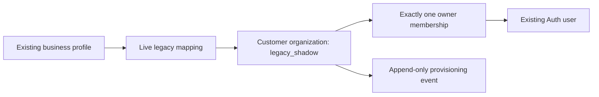

# ORG-01B — shadow organizations: design and requirements

28 October 2026. **Implemented and preview-accepted by the owner on 28 October 2026.** This document retains the design requirements; [implementation evidence and rollout](org-01b-preview-validation.md) records what was delivered, owner acceptance and the pending production release. Parent contract: [ORG-01A](org-01-organization-architecture.md). “Shadow” means internal metadata that does not authorize customer access or replace the existing account-owned record. The owner subsequently reported production backfill `COMPLETE` on 28 October 2026 (two profiles/two active organizations, zero archived/unmapped/conflicts); this is not an independent production catalog/runtime check.

## Intended result

Every existing business profile, and every newly committed business profile after installation, has one stable customer organization, one matching legacy-account mapping and one initial owner membership. Creating these records is atomic and repeatable. Existing customers keep the same business-profile ID, financial records, plan versions, billing, quotas and application flows.

The same identity model applies to Starter, Core, Growth, Advisory, suspended and unpaid accounts that already have a valid business profile. Creating organization identity is independent of purchasing capabilities. No invitation, second member, client switcher, practice, advisor assignment, billing link or shared quota becomes available in B. New organization rows are explicitly non-routable; legacy authorization remains authoritative.

## Decisions for B

| Decision | Requirement |
| --- | --- |
| Organization IDs | Generate an independent UUID once and persist it. Preserve the existing profile ID in the mapping. Do not use email, Stripe IDs or a user's Auth UUID as the new organization's identity. |
| Provisioning boundary | One private database routine, used by a trusted profile-insert trigger and a service-only ensure/backfill entry point. Browser roles get no direct metadata writes or callable provisioning RPC. |
| Commit behavior | Profile creation and its new metadata commit together. A provisioning failure rolls back the profile-creation transaction through its existing error path; it must not silently leave a successful but unmapped new profile. |
| Legacy readers/writers | No organization-based customer routing, replacement RLS, changed feature gate or new HTTP endpoint. Existing profile updates, imports and financial locks retain their behavior. |
| Existing-profile backfill | Run bounded, repeatable batches after installing the hook. A rerun verifies the original mapping; it never recreates ownership or “repairs” a revoked membership. |
| Ownership shape | Exactly one owner membership per shadow organization. Other roles and additional memberships are blocked in B's database constraints, not merely absent from the UI. |
| Name | Nullable initial copy of the profile's current business name, explicitly labelled as a snapshot. The profile remains the authoritative name. B does not add name synchronization or use the snapshot in customer UI. |
| Deleted profile/identity | Detach and archive shadow records; retain minimal audit/provenance. Never use an Auth-user cascade to delete the new organization or its audit history. Existing financial deletion behavior is not widened or redesigned in B. |
| Billing | No billing/Founding/usage conversion or new billing authorities in B. Those are later contracts before collaboration. |

“Server-controlled mutation” is more precise than “service-only mutation”: normal authenticated profile insertion already exists, and its trusted database hook must be allowed to derive fixed metadata. That hook grants no new runtime access. Only the operator ensure entry point is directly executable by `service_role`; the trigger/private routine is not callable by browser roles.

## Verified creation paths

A read-only inspection of the confirmed Supabase preview catalog on 28 October found one profile timestamp-update trigger and no custom Auth-user/profile-creation trigger. Profiles are created lazily, not automatically at signup. `business_profiles.id` and `user_id` are non-null UUIDs; `user_id` is unique; its owner FK currently cascades Auth deletion. The authenticated profile policy checks `auth.uid() = user_id` for both existing and inserted/updated rows. No production schema was inspected.

| Current path | How a profile can appear | B coverage |
| --- | --- | --- |
| Dashboard and Settings loads | [getOrCreateBusinessProfile](../lib/db.ts) reads, then upserts the caller's profile if absent. | The committed INSERT invokes the hook; an existing-row return remains read-only. |
| Business-name and threshold saves | [Account](../app/api/account/route.ts) and [Settings](../app/api/settings/route.ts) call the profile upsert helper. | INSERT is covered; a routine UPDATE must not reprovision or reset membership. |
| Imports and review preparation | Active preview functions `financial_import_v2_is_unchanged`, `import_financial_data`, `import_financial_data_v2` and `import_reviewed_financial_data` can insert the missing profile. | Same hook inside the existing database transaction; failed review/import rolls back any newly created metadata too. |
| Clear Data | `clear_financial_data_preserving_settings` inserts a missing profile before its existing monthly-data operation. | Same hook; do not change which financial records Clear Data removes or preserves. |
| Onboarding completion | [Onboarding](../app/api/onboarding/route.ts) updates an existing profile and does not create one. | No additional provisioning call or unrelated signup side effect. |
| Auth signup alone | Creates an Auth identity without the custom profile hook in this preview catalog. | No organization until a legitimate profile is created. |

The final executable migration must repeat this catalog preflight: another environment may have different hooks/functions. Do not replay older function migrations to make its schema resemble preview. A new database hook covers all legitimate INSERT paths without editing five old financial functions and several application callers.

## Record design

The implemented tables live in `public` with RLS and no `anon`/`authenticated` grants or policies. Internal routines live in a non-exposed `organization_private` schema. All timestamps use the database clock. The field contracts below are installed in preview; production installation/backfill was subsequently reported complete by the owner; independent production runtime acceptance is separate.

### `organizations`

| Field | Design |
| --- | --- |
| `id` | UUID PK, generated once. |
| `kind` | Text constrained to `customer` in B. Enabling practice organizations requires a later migration. |
| `access_mode` | Text constrained to `legacy_shadow`. No boolean that silently enables collaboration. |
| `lifecycle` | `active` or `archived`. Active here means valid shadow identity; it does not mean a paid account or an enabled access resolver. |
| `display_name` | Nullable text, initial exact copy of `business_profiles.business_name`; no fallback name stored for a blank value. |
| `display_name_source` | Fixed `legacy_profile_snapshot`. Owner reads in C must use the current canonical name or explicitly establish synchronization before presenting this field as current. |
| `access_revision` | Positive bigint, initially 1; increases on actual shadow lifecycle/access changes. An exact ensure replay does not advance it. |
| `created_at`, `updated_at`, `archived_at` | Creation/update times and nullable archive time; lifecycle/archive consistency checked. |

### `organization_memberships`

| Field | Design |
| --- | --- |
| `id` | Stable UUID PK. |
| `organization_id` | Non-null FK to `organizations(id)`, delete restricted. |
| `user_id` | Nullable FK to `auth.users(id)` with `ON DELETE SET NULL`; active membership requires a non-null live user. |
| `legacy_subject_user_id` | Immutable UUID provenance of the original principal; no cascading Auth FK. While `user_id` is non-null it must equal this value. This is an identity reference, not an email or proof of a human grant decision. |
| `role` | Constrained to `owner` for B. |
| `status` | `active` or `revoked`. |
| `origin` | Fixed `legacy_profile_owner`; no claim that a customer accepted an invitation. |
| `revision`, timestamps | Positive revision; created/updated/revoked times. Revocation/reference tombstoning must be attributable and monotonic. |

Use `UNIQUE(organization_id)` to enforce B's one-membership scope and retain `UNIQUE(organization_id,user_id)` for the future model. Do **not** make `user_id` globally unique: a person may eventually have memberships in several organizations. A narrow internal tombstone hook changes a membership to revoked before an Auth-FK `SET NULL` update is checked; it cannot activate a user, move a membership or change its role. Removing the one-member/owner-only restrictions is an explicit later migration after domain authorization is ready.

### `legacy_account_organizations`

| Field | Design |
| --- | --- |
| `legacy_business_profile_id` | UUID PK, immutable original profile reference; preserved after deletion. It is provenance and intentionally not a cascading FK. |
| `current_business_profile_id` | Nullable unique FK to `business_profiles(id)`, `ON DELETE SET NULL`. When present it must equal `legacy_business_profile_id`. |
| `legacy_user_id` | Immutable UUID of the profile's original account owner; no cascading Auth FK. |
| `organization_id` | Non-null unique FK to the shadow organization, delete restricted. |
| `state` | `live` or `detached`; live iff the current profile reference exists. |
| `provisioning_operation_id` | UUID identifying the winning provisioning operation, retained on exact retry. |
| `created_at`, `detached_at` | Creation and nullable detachment time, consistent with state. |

Add a partial unique index on `legacy_user_id WHERE state='live'`. Historical detached mappings may coexist with a newly created profile for that account; two live profiles may not map that legacy account twice. This uniqueness is a **legacy bridge** constraint, not a future one-user/one-organization ownership rule.

At commit, each live mapping must match the persisted profile owner, one active owner membership with that live Auth identity and an active customer/legacy-shadow organization. Each active shadow organization must have exactly one such mapping and membership. Cross-table assertions need narrowly scoped deferred constraint triggers or an equivalent proven database mechanism; a row `CHECK` alone is insufficient. Direct table mutation through migration/maintenance roles must not quietly commit a half-created graph. [PostgreSQL constraint guidance](https://www.postgresql.org/docs/17/ddl-constraints.html), [constraint triggers](https://www.postgresql.org/docs/17/sql-createtrigger.html).

### `organization_access_events`

| Field | Design |
| --- | --- |
| `id`, `organization_id` | UUID PK and restricted organization FK; no deletion cascade. |
| `event_type` | Closed B vocabulary: `legacy_organization_provisioned` or `legacy_profile_detached`. |
| `operation_id`, `policy_version` | Winning operation correlation and fixed `org-shadow-1` policy. |
| `actor_kind`, `actor_reference` | `system` with a nullable reference in B. A hook/backfill is not a customer-approved invitation or ownership transfer. Do not invent human attribution from the subject's UUID. |
| `subject_user_reference`, `business_profile_reference`, `membership_reference` | Minimal immutable UUID provenance. Historical principal references do not carry Auth deletion FKs. |
| `origin`, `resulting_access_revision`, `occurred_at` | Fixed trusted creation origin (`profile_insert` or `service_ensure`) or explicit `profile_detach`, committed revision and database time. |

One event of each type per organization: `UNIQUE(organization_id,event_type)`. A batch/run operation ID may cover several organizations; it is not the ownership/idempotency key. No raw Auth metadata, email, financial snapshot, token or provider response is stored. Replays append no duplicate event. Reject updates/deletes through ordinary service/application paths. The new records remain internal; retention/purge after this migration phase requires a separate explicit policy, not an unreviewed destructive rollback.

## Provisioning transaction and API contract

Use one private routine for the write logic. Its service-facing wrapper is provisionally named `ensure_legacy_organization(p_business_profile_id uuid, p_expected_user_id uuid, p_operation_id uuid)`. It receives a profile selector and expected legacy owner, never an organization ID, role, tier, membership state or billing identity. It does not create/update a profile. This is an operator/backend entry point, not a new user-facing API.

1. Validate non-null IDs and require READ COMMITTED for B's provisioning transactions; reject stronger isolation modes explicitly rather than reusing a stale transaction snapshot after waiting. Mutation routines are VOLATILE. Lock the persisted profile row first, matching existing import/Clear Data/profile lock order. Missing profiles fail without creating records.
2. Compare the persisted profile's `user_id` with the expected owner; verify the live Auth identity through checked FKs. Never trust a supplied expected owner on its own.
3. Look up the mapping by the immutable original profile ID. If a complete live mapping exists, validate the entire graph and return its original IDs/operation with `created=false`. No timestamp, name, revision, role, quota or audit write on this path.
4. If a detached mapping exists for that same original profile ID, or any live uniqueness/owner/graph invariant conflicts, return a bounded integrity error. Do not attach a reused profile UUID to archived history, silently unarchive, regrant ownership or stitch together orphan rows.
5. Otherwise create the customer organization, fixed owner membership, checked live mapping and provisioning event in one transaction, using the persisted profile owner and server-generated IDs/times.
6. Validate the cross-table invariants before commit. Return only `{organization_id,membership_id,business_profile_id,provisioning_operation_id,created}` to the trusted caller. The profile-insert trigger returns the original profile row, so existing application responses are unchanged.

`p_operation_id` is correlation for the first winner; a second request with a different operation ID for the same valid profile returns the winner rather than making a second organization. A changed expected owner fails before the replay check. No generic “repair membership” option exists. A partial graph fails closed and is reported for reviewed repair.

The `AFTER INSERT` profile trigger invokes the same routine using only persisted `NEW.id` and `NEW.user_id`. If Auth session identity is present, require it to agree with that owner. Existing RLS remains in force on the originating profile INSERT; service/admin inserts are privileged maintenance paths. The privileged trigger must validate its table/operation context, use a fixed empty search path, schema-qualified references and no dynamic SQL. Trigger bodies and helpers get no browser-executable entry point. Revoke default PUBLIC function execution in the installation transaction. [PostgreSQL function security](https://www.postgresql.org/docs/17/sql-createfunction.html), [Supabase function privileges](https://supabase.com/docs/guides/database/functions).

Add a narrow identity guard rejecting changes to an existing profile's `id` or `user_id`; these are not an organization-transfer interface. Reassigning ownership is a later membership workflow. Ordinary name, threshold, onboarding and data-version updates still follow their existing paths and do not rerun shadow provisioning. The existing `trg_business_profiles_updated_at` trigger remains installed.

## Deletion and recreated profiles

Deleting an Auth identity currently deletes its legacy profile through the existing FK. B must not add a new Auth cascade into `organizations` or `organization_access_events`, or turn shared ownership on prematurely.

When the profile FK nulls `current_business_profile_id`, a narrowly scoped mapping hook sets the mapping to detached, archives its legacy-shadow organization, revokes the original membership and appends one detach event in that same transaction. Auth-FK membership tombstoning preserves the original principal reference and leaves no active membership with a null user. Deferred invariants validate the **final** graph, regardless of FK-trigger firing order. Referential actions such as `SET NULL` execute with the modifying command; deferring a constraint does not defer all FK actions. Test the actual cascade order rather than assuming it. [PostgreSQL foreign-key actions](https://www.postgresql.org/docs/17/sql-createtable.html).

Only a legacy-shadow organization can take this automatic archive path. A later resolver/collaboration release must replace these guards before organization-owned financial data or shared memberships exist. A direct service deletion of metadata remains prohibited. If an existing legacy FK already prevents Auth deletion (for example, retained purchase references), B must not bypass that protection; the entire attempted deletion, including shadow changes, rolls back.

If the same surviving Auth account later receives a new profile with a **new** profile UUID, provision a new shadow organization. Keep the old mapping detached. A reused historical profile UUID is an integrity conflict requiring review; it must not automatically regain access to old history. No organization reactivation, data restoration or account-deletion UI is introduced here.

## Permission and mutation surface

| Principal | New table reads | New table writes | Ensure wrapper | Private/trigger routines |
| --- | --- | --- | --- | --- |
| `anon` / `authenticated` | Denied | Denied | Denied | Denied as direct calls |
| `service_role` | Minimal SELECT for verification/operations | No direct DML | EXECUTE | No direct execution/schema usage |
| Migration/function owner | Controlled deployment/maintenance access | Fixed routines and reviewed migrations | Controlled | Installs/invokes trusted hooks |

Enable RLS on all four new tables, remove inherited/default PUBLIC and browser privileges, and add no unconditional policies. Use no browser-readable views or exposed-schema helper overloads. Metadata mutation routines run with a reviewed definer owner; service execution grants alone must not depend on an `auth.uid()` that is absent in service calls. The authenticated profile hook binds a present actor as above. Validate actual runtime trigger execution with browser function grants revoked; do not “fix” a failing hook by exposing the routine to clients.

Failure categories are fixed and safe: missing profile, owner mismatch, legacy mapping conflict, unsupported transaction mode and temporary lock/deadlock/storage failure. Do not expose SQL detail containing financial data, Auth metadata or secrets. No web endpoint is added just to expose these outcomes. Existing profile/import error boundaries remain responsible for their existing customer responses.

## Backfill and reconciliation

Install all four tables, constraints, functions and hooks atomically before backfill. Existing profiles may temporarily be unmapped during the backfill window because no runtime behavior consumes shadow metadata. New profile INSERTs after installation must commit with their metadata. An interrupted operator run must not leave newly inserted profiles dependent on a future cron job.

The operator script has an explicit read-only plan mode and a separate apply mode. Neither writes financial/profile/billing rows. Apply uses the service-only entry point, default batches of 100 profiles and a maximum requested batch size of 500; reject non-integer or out-of-range batch sizes. Lock profiles in ascending UUID order. Use one PostgreSQL connection with explicit `BEGIN/COMMIT` per batch at READ COMMITTED; independent HTTP RPC calls cannot provide that batch transaction. Hold no locks across operator/user input or provider/email/HTTP calls. Each batch commits or rolls back completely. Default to a two-second lock timeout, a 30-second statement timeout and a 60-second wall-clock batch deadline with cancellation/rollback on expiry. Allow at most three retries for a confirmed transaction-abort/lock-contention class, with a fresh transaction and bounded delay. Never retry an integrity mismatch as though it were transient.

A restart may scan from the beginning; exact ensures are no-ops. A cursor is an optimization, not proof of completion: random UUIDs and concurrent inserts can appear before an old high-water mark. Finish with a fresh reconciliation over all live profiles, including previously skipped/locked profiles, until the outstanding set is empty under the installed provisioning hook. Backfill is single-operator by default; two competing operators must still converge under the same profile lock and uniqueness constraints.

Plan/report only aggregate counts by category in ordinary output. Sensitive operator diagnostics stay local and Git-ignored; do not commit customer UUID lists or financial snapshots. No fixed customer IDs or environment-specific project IDs belong in migrations.

| Preflight or reconciliation finding | Required handling |
| --- | --- |
| Profile uniqueness/FKs/nullability or unexpected custom hooks differ from the assumed baseline | Stop schema installation or the affected operation with a bounded diagnostic. Review the exact catalog; do not rewrite old migrations. |
| Valid profile, no mapping | Eligible for ensure, regardless of tier/subscription status or missing financial history. |
| Complete consistent live mapping | Report verified; exact no-op. |
| Incomplete/foreign mapping, reused historical profile ID, missing expected Auth principal | Block that provisioning transaction; leave original records untouched and require reviewed repair. |
| Nullable `business_id` on legacy financial/action rows | Inventory as an ownership-migration issue; B does not assign it an organization or rewrite it. |
| A financial row's `user_id` conflicts with its `business_id` owner | Quarantine from later domain conversion; report a conflict. A valid profile may still obtain shadow identity, but this does not certify that domain for C/D. |
| Auth user without a profile | Report separately if inventoried; do not create a profile, organization or subscription solely for backfill. |
| Detached historical mapping and a distinct new live profile | Preserve the old archive; provision/verify the new identity independently. |

Completion is an invariant result, not equality of total row counts: historical archives mean organization count can exceed current profile count. Every live profile must have exactly one consistent live mapping, one active shadow organization and its single matching owner. Every active shadow organization must resolve back to exactly one live profile. Detached organizations remain archived with no active owner and with one detach event. The repeat run must preserve IDs, metadata timestamps/revisions and event counts for unchanged inputs.

## Concurrency and compatibility

B uses **profile → mapping → organization → membership/event** for existing-profile ensure/detach work, preserving the profile-first boundary of existing writers. A newly inserted profile is already inside its creating transaction. The ensure path on a complete mapping performs no organization update or later-lock acquisition just to mark it “seen.” Deleted profiles, Auth FK actions and duplicate inserts can contend: tests must prove atomic outcomes and bounded deadlock/lock failure handling, not promise that database contention is impossible.

This is explicitly a legacy-shadow lock order. It must not be copied into future converted organization-authorized writes, whose ORG-01A order starts with participating authorization roots. Before C/D introduces interacting authorization locks, review/retire the affected B hooks and wrappers so no path acquires the reverse order. No application component may start treating the new `owner` membership as runtime authority just because it exists.

Full compatibility requirements:

- Preserve existing profile/financial/forecast IDs, values, foreign keys, `data_version`, revision snapshots and immutable evidence. No `organization_id` backfill onto financial rows in B.
- Preserve Stripe subscriptions/customers/prices/status, Founding identity, cancellation behavior, usage rows, action limits and paid-call purchases byte-for-byte for a metadata-only ensure/backfill run.
- Preserve profile defaults and timestamp behavior; do not issue a legacy profile UPDATE merely to provision metadata. A new profile's normal timestamps remain its insertion values.
- Preserve the distinction between blank/zero financial inputs; provisioning creates no financial month, empty forecast or default cash amount.
- Preserve current profile creation eligibility. The hook must not newly demand a paid plan or verified email for a database operation that is already legitimately allowed by existing Auth/RLS policy.
- Preserve existing `getOrCreateBusinessProfile` return shape and existing API responses. No new organization IDs, membership roles or internal status fields in browser JSON.
- Preserve the QuickBooks parking decision, Core/Growth/Advisory feature gates and current sales flags.

Strict atomicity introduces a new internal failure dependency on profile creation: if the shadow write fails, the profile INSERT fails too. This is a deliberate correctness requirement, not a promise that the new hook cannot cause errors. Installation, failure-injection, permissions, latency and contention tests must validate it before production. Do not mask errors with a successful orphaned profile or silently downgrade to best-effort provisioning.

## Acceptance and operational evidence

These are the implementation acceptance requirements. [Validation evidence](org-01b-preview-validation.md) distinguishes the completed local/database checks from owner-reported hosted preview acceptance.

| ID | Test | Required evidence |
| --- | --- | --- |
| B-01 | Backfill existing owners across representative account/tier states | One consistent shadow graph per live profile; no financial or billing changes. |
| B-02 | Repeat ensure/backfill, including a new operation ID | Same record IDs and original operation; unchanged revisions, timestamps and event count. |
| B-03 | Two sessions ensure the same old profile | One creation; waiter verifies/replays the committed winner. Rollback of the first permits the second to create once. |
| B-04 | Two sessions create the same account's missing profile via existing upsert | One profile and graph; no duplicate key surfaced merely because the shadow hook raced. Preserve existing upsert behavior. |
| B-05 | Backfill and a live import/profile insert overlap | Every committed new profile mapped; operator restart/final scan finds no gap. |
| B-06 | Call each current creation path with a missing profile | Hook works for authenticated and service callers; caller's existing response/error contract is preserved. |
| B-07 | Inject failure after each new-record insert and before commit | Entire metadata graph and newly inserted profile roll back; a preexisting profile and its financial data remain unchanged. |
| B-08 | Wrong expected owner, inconsistent partial graph or unsupported isolation mode | No repair, regrant, data movement or extra event; bounded integrity/configuration error. |
| B-09 | Browser roles query tables/views or call helper/RPC overloads | Denied; legitimate own-profile INSERT still succeeds through the trusted hook. Foreign profile insertion remains denied by legacy RLS. |
| B-10 | Service role tries direct table DML, extra membership, non-owner role or routable/practice mode | Direct DML denied; database constraints also reject unsupported states under a controlled verifier. |
| B-11 | Name/threshold/onboarding save, unchanged review/import and Clear Data | No reprovision; old semantics/defaults/data-version behavior remain intact. Clear Data does not detach its preserved profile. |
| B-12 | Allowed direct profile deletion and Auth cascade; deletion blocked by an existing FK | Allowed deletion yields an archived/tombstoned shadow graph; blocked deletion rolls everything back. Preserve prior legacy deletion restrictions. |
| B-13 | Profile deletion races ensure/backfill | No active orphan, stale owner regrant or partial detach. Surviving state meets final invariants, with bounded transaction-abort recovery. |
| B-14 | New profile for the surviving account versus reuse of old profile UUID | New UUID creates independent identity; reused historical UUID is rejected for review. |
| B-15 | Bulk backfill interrupt/resume and concurrent insert before UUID cursor | Idempotent restart plus full reconciliation completes; no cursor-only false success. |
| B-16 | Full existing regression suite and representative hosted owner flows | Current dashboard, profile saves, import/review/confirm, plans/cases/reviews, settings and billing access retain behavior. |

Use local PostgreSQL/PGlite tests for invariants and fault injection, and real preview PostgreSQL with two independent sessions for locking and actual role/trigger behavior. Preview fixtures must roll back; do not delete real Auth accounts to test cascades. Use disposable fixture identities under a transaction, respecting existing immutable-history triggers. Snapshot relevant legacy rows before/after a metadata-only run and compare values, not just counts.

## Implementation deliverables and rollout

The implementation should contain one new dated expansion migration; private provisioning/tombstone/invariant routines plus the service wrapper; a preview-only rollback verifier; a guarded operator plan/apply/reconcile script; focused database/privilege/concurrency tests; and updated release documentation. App/financial function rewrites are unnecessary unless an actual compatibility failure proves a bounded change is required. A local test engine alone does not establish Supabase trigger/role behavior.

1. Recheck the target preview catalog and capture read-only plan output. Explicitly guard the preview project reference in validation tooling.
2. Install reviewed DDL/hooks transactionally with bounded DDL lock timeouts. Do not claim completion if installation/backfill is partial.
3. Run backfill and reconciliation, role-negative tests, rollback/failure probes, real two-session contention and unchanged-legacy comparisons in preview.
4. Run the existing regression suite and hosted owner acceptance. Document outstanding legacy ownership conflicts separately from shadow-identity completion.
5. Prepare a production installation/backfill plan with the same catalog preflight and invariant reporting. Production applies only reviewed migrations/authorized operational backfill; **never** the preview verifier. This design task authorizes no production execution.

Before collaboration, rollback means preserving the four internal tables/history and leaving all customer routing legacy-owned. If the new insert hook causes a verified incident, a reviewed incident migration may temporarily disable **only** shadow provisioning, retaining existing identity/ownership guards where safe; record the gap interval and stop declaring B complete. Profile creation may then temporarily produce unmapped rows because no runtime feature depends on them. Repair the defect, re-enable the hook, backfill the gap and reconcile before further organization rollout. Never drop organizations or delete evidence as a routine rollback, and never leave a best-effort fallback enabled without recording its loss of the atomic mapping guarantee.

## Decisions deferred beyond B

Seats/pricing, practice packaging, advisor engagement fulfillment, shared quota enforcement, billing/Founding transfer rules, organization-level export entitlements, professional notes, domain RLS conversion and shared-data deletion remain later work. B needed none of those commercial decisions to create internal identity. After B owner smoke acceptance and its separate production release decision, ORG-01C can introduce an owner-only resolver/read conversion; team access remains disabled.

## Design validation

At the initial design-only stage, repository and read-only preview metadata checks passed, 40 relative links resolved, and the then-current 1,345-test suite passed; no database writes occurred in that stage. The subsequent [implementation record](org-01b-preview-validation.md) supersedes that design-only status: preview implementation passed 1,369 tests, the production operational-file follow-on passed 1,372 tests, and the owner then supplied a production `COMPLETE` result. Production execution evidence is user-reported; no independent production connection/catalog/runtime check was made.
